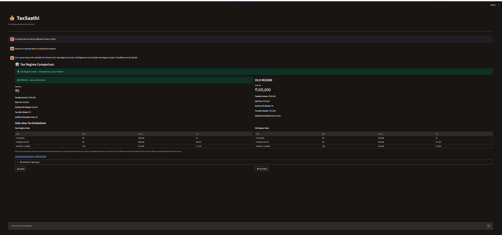
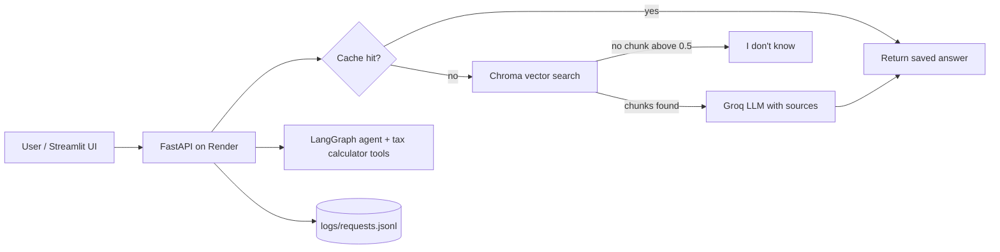

# TaxSaathi 💰

[](https://github.com/Kunalshinde2627/gen_ai/actions/workflows/ci.yml)

**Live API:** https://taxsaathi-api.onrender.com

**Swagger Documentation:** https://taxsaathi-api.onrender.com/docs

**Health Check:** https://taxsaathi-api.onrender.com/health

TaxSaathi is an AI-powered Income Tax Assistant designed to help freshers understand income tax, compare the old and new tax regimes, and find relevant Income Tax Department information.

## Who is it for?

Freshers who have received their first salary and want to understand:

- Income tax basics
- Old vs New Tax Regime
- Estimated tax liability
- Relevant income tax rules and sources

## Project Screenshot



## Features

### 1. Search and RAG

- Keyword search and TF-IDF smart search
- Semantic search with embeddings and Chroma vector store
- RAG-based answers using retrieved information
- Source citations and reference links
- Safe fallback when the available data cannot answer a question

### 2. Tax Calculation

- New Regime tax calculator
- Old Regime tax calculator
- Old vs New Regime comparison
- Slab-wise tax breakdown
- Section 87A rebate and 4% cess calculation
- Highlights the regime with lower estimated tax

### 3. AI Agent and Human Approval

- Agent workflow using LangGraph
- Human-in-the-loop approval
- Resume workflow after approval or rejection
- MemorySaver checkpointer for conversation state

### 4. Streamlit Chat Interface

- Interactive chat interface
- Backend integration with FastAPI
- Chat history during the session
- Source and calculation details
- Thumbs Up / Thumbs Down feedback
- Feedback stored in `data/feedback.json`

### 5. REST API

- FastAPI backend
- API documentation using Swagger UI
- Endpoints for search, records, questions and agent execution

### 6. Evaluation

- Evaluation of 15 questions
- Comparison of different retrieval configurations
- Winner table based on correctness, citations and refusal behaviour

## Tech Stack

- Python
- Streamlit
- FastAPI
- LangGraph
- RAG
- ChromaDB
- Embeddings
- pandas
- scikit-learn
- LLM integration
- Docker
- Git and GitHub
- GitHub Actions
- Render

## Data Sources

Official Income Tax Department:

https://www.incometax.gov.in

- Help pages stored in `data/raw`
- Tax records stored in `data/sample_records.json`
- Retrieved source information is used to support RAG answers.

## Project Structure

```text
TaxSaathi/
│
├── app/
│   ├── main.py
│   ├── graph.py
│   ├── agent_loop.py
│   ├── rag.py
│   ├── vectorstore.py
│   ├── tools.py
│   ├── records.py
│   ├── smart_search.py
│   └── llm.py
│
├── ui/
│   └── app.py
│
├── data/
│   ├── raw/
│   ├── sample_records.json
│   └── feedback.json
│
├── docs/
│   ├── ui-screenshot.png
│   └── interview.md
│
├── eval/
│   ├── eval_set.json
│   └── run_eval.py
│
├── requirements.txt
├── README.md
└── .env.example
```

*Note: The structure above shows the main project files. Docker, tests and other configuration files may also be present in the repository.*

## How to Run

### 1. Clone the repository

```bash
git clone https://github.com/Kunalshinde2627/gen_ai.git
cd gen_ai
```

### 2. Create a virtual environment

```bash
python -m venv .venv
```

Activate it:

**Windows PowerShell:**

```powershell
.venv\Scripts\Activate.ps1
```

### 3. Install dependencies

```bash
python -m pip install -r requirements.txt
```

### 4. Configure environment variables

Create a `.env` file using `.env.example` and add the required API key and model configuration.

Do not upload your API key to GitHub.

### 5. Build the vector store

```bash
python -m app.vectorstore
```

### 6. Start the FastAPI backend

```bash
python -m uvicorn app.main:app --reload
```

Backend URL:

http://127.0.0.1:8000

Swagger documentation:

http://127.0.0.1:8000/docs

### 7. Start the Streamlit UI

Open another terminal and run:

```bash
python -m streamlit run ui/app.py
```

Streamlit will display a local URL, usually:

http://localhost:8501

## RAG Evaluation

I wrote 15 questions in `eval/eval_set.json`: 13 can be answered from my data and 2 cannot.

Each answer is scored on three things:

- **Correct:** The answer contains the expected keyword.
- **Cited:** The answer has a citation.
- **Refused:** For the 2 unanswerable questions, TaxSaathi says "I don't know".

I compared two settings: how many chunks are given to the LLM (`top_k` = 3 or 5).

| Config | top_k | Correct | Cited | Refused when unanswerable | Score |
|---|---:|---:|---:|---:|---:|
| A (winner) | 3 | 11/13 | 12/13 | 2/2 | 13/15 |
| B | 5 | 10/13 | 11/13 | 2/2 | 11/15 |

**Winner: Config A (top_k=3).**

With 5 chunks, the LLM received more less-relevant text and answered worse.

## Architecture



## Production Notes

Measured on my laptop (not on Render) by running my 15 evaluation questions twice through `POST /ask` (`python -m eval.measure`).

| Measure | Result |
|---|---|
| Requests logged | 30 (0 errors) |
| Cache hit rate | 50% (second round was served from the cache) |
| Latency without cache | About 1.5 s on average, 2.1 s at p95 |
| Latency with cache | Under 1 ms |
| Tokens per question that used the LLM | About 600 on average, 813 at most |
| Total tokens for 14 LLM calls | 8,441 |

What I added to make it safer and easier to run:

- **Logging:** Every `/ask` request writes latency, tokens, cache hit and errors to `logs/requests.jsonl`. Only the first 80 characters of the question are saved.
- **Cache:** The same question does not call the LLM again (100 answers, kept for 1 hour).
- **Input limits:** An empty question or one longer than 500 characters gets a `400` error.
- **Secrets:** The Groq key lives only in `.env` (local) and in Render environment variables. It is never committed.
- **CI:** GitHub Actions runs Ruff, 42 pytest tests and a Docker build on every push.

## Load Testing

A basic concurrency test was performed against the deployed health endpoint using Python `ThreadPoolExecutor`.

Three simultaneous requests returned successful HTTP `200` responses.

| Request | HTTP Status | Response Time |
|---|---:|---:|
| 1 | 200 | 1.01 s |
| 2 | 200 | 0.89 s |
| 3 | 200 | 0.88 s |

This is a basic API concurrency check, not a high-volume stress test.

## Interview Preparation

Project explanation, RAG architecture walkthrough, GenAI interview questions, Python and API questions, and project-based interview questions are available in:

`docs/interview.md`

## Deployment

TaxSaathi API is deployed on Render.

- **Live API:** https://taxsaathi-api.onrender.com
- **Swagger UI:** https://taxsaathi-api.onrender.com/docs
- **Health Check:** https://taxsaathi-api.onrender.com/health

## Known Limits

- When no source scores 0.5 or higher, TaxSaathi says "I don't know". This is safer than guessing, but a few good questions are refused too (see Q5 in the evaluation).
- Prompt-injection tests check that the attack text stays in the user message, and that off-topic attacks get a refusal without calling the LLM. A clever attack on a question with matching sources could still confuse the model.
- The free Render server sleeps after 15 minutes. The first request after that can take about a minute.
- The numbers above are from my laptop. Render will be slower.
- The concurrency test covered only three simultaneous health requests.
- TaxSaathi is a learning project. Please confirm tax numbers on incometax.gov.in.

## Disclaimer

TaxSaathi provides educational information and estimated tax calculations. It is not a substitute for professional tax advice. Always verify current tax rules and calculations with the official Income Tax Department website.
