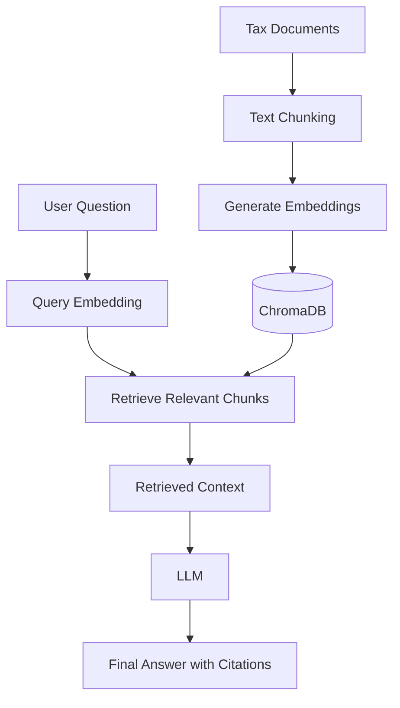

# TaxSaathi – Interview Preparation

## 1. Tell me about your project (60-second introduction)

Hello, I would like to introduce my project, TaxSaathi.
TaxSaathi is an AI-powered income tax assistant developed to help users understand Indian income tax.
I built this project using Python and FastAPI for the backend. I used LangGraph to build an AI agent and ChromaDB as a vector database for storing and retrieving tax-related information.
It uses Retrieval-Augmented Generation (RAG) to provide answers based on relevant tax documents with citations.
The project also includes features like tax-related question answering, old and new tax regime comparison, and human approval for important actions.
I used Docker to containerize the application and GitHub Actions for CI/CD. Finally, I deployed the application on Render.
Through this project, I learned about Generative AI, RAG, vector databases, API development, Docker, and deployment.
Thank you.

## 2. Top 10 GenAI Interview Questions

### Q1. What is RAG (Retrieval-Augmented Generation)?
**Answer:**
RAG stands for Retrieval-Augmented Generation.
It is a technique that combines information retrieval with Large Language Models (LLMs).
First, it retrieves relevant information from documents or a vector database. Then, the LLM uses that information to generate an accurate answer.
In my TaxSaathi project, I use ChromaDB to retrieve relevant tax-related information and provide context to the LLM. This helps generate answers based on the available tax documents.

### Q2. What is an LLM (Large Language Model)?
**Answer:**
LLM stands for Large Language Model.
It is an AI model trained on large amounts of text data to understand and generate human-like responses.
Examples of LLMs include GPT, Gemini, and Llama.
In my TaxSaathi project, an LLM understands the user's tax-related questions and generates responses using the context retrieved through RAG.

### Q3. What are Embeddings?
**Answer:**
Embeddings are numerical representations of text, such as words, sentences, or documents, in the form of vectors.
They help computers understand the semantic meaning of text.
In my TaxSaathi project, embeddings convert tax-related documents and user queries into vectors. ChromaDB uses these vectors to find semantically similar information.
**Example:** "Income tax" and "Tax payment" may have similar meanings, even though the words are different.

### Q4. What is a Vector Database?
**Answer:**
A vector database is a database designed to store and search vector embeddings.
It finds similar information based on semantic meaning rather than only exact keyword matching.
In my TaxSaathi project, I use ChromaDB as a vector database. It stores embeddings of tax-related documents and helps retrieve relevant information when a user asks a question.
**Example:** If a user asks about "income tax payment", it can retrieve related content about "tax payment methods".

### Q5. What is an AI Agent?
**Answer:**
An AI Agent is a system that can understand a user's request, make decisions, and perform tasks using available tools.
Unlike a simple chatbot, an AI Agent can follow multiple steps to complete a task.
In my TaxSaathi project, I use LangGraph to build an AI Agent. It manages the workflow, processes user requests, and supports human approval for important actions.

### Q6. What is LangGraph?
**Answer:**
LangGraph is a framework used to build stateful and multi-step AI agent workflows.
It represents workflows using nodes and edges. Nodes perform tasks, while edges define the flow between tasks.
In my TaxSaathi project, I use LangGraph to manage the AI agent workflow, including processing user requests and handling human approval.

### Q7. What is FastAPI?
**Answer:**
FastAPI is a modern Python web framework used to build APIs.
It is fast, easy to use, and supports automatic API documentation through Swagger UI.
In my TaxSaathi project, I use FastAPI to create backend APIs that accept user questions, process requests, and return responses.
I can test these APIs using Swagger UI at the `/docs` endpoint.

### Q8. What is Docker?
**Answer:**
Docker is a platform used to containerize applications.
A container packages an application with its dependencies and configuration so it can run consistently in different environments.
In my TaxSaathi project, I use Docker to package the FastAPI application and its dependencies. This makes deployment easier and more consistent.

### Q9. What is Human-in-the-Loop (HITL)?
**Answer:**
Human-in-the-Loop is an approach where a human reviews or approves an AI system's decision before an important action is completed.
It helps improve safety, control, and reliability.
In my TaxSaathi project, I use human approval for important actions. The system asks for approval before completing the requested action.
**Example:** Before performing an important tax-related action, the system waits for user approval.

### Q10. How do you evaluate a RAG system?
**Answer:**
A RAG system can be evaluated based on retrieval quality and answer quality.
Some important evaluation metrics are:
1. **Faithfulness:** Is the answer supported by the retrieved context?
2. **Answer Relevance:** Does the answer correctly address the user's question?
3. **Context Precision:** Are the retrieved documents relevant?
4. **Context Recall:** Does the system retrieve the important information needed to answer?
In my TaxSaathi project, I check whether relevant tax information is retrieved and whether the generated answer is supported by the available documents.

## 3. TaxSaathi RAG System Architecture
**Answer:**

My TaxSaathi project follows a Retrieval-Augmented Generation (RAG) architecture.

The workflow has the following steps:

1. **Document Loading:** Tax-related documents are loaded into the system.
2. **Text Chunking:** Documents are divided into smaller chunks.
3. **Embedding Generation:** Each chunk is converted into a numerical vector using an embedding model.
4. **Vector Storage:** Embeddings are stored in ChromaDB.
5. **User Query:** The user asks a tax-related question.
6. **Retrieval:** The system searches ChromaDB for relevant information.
7. **Context Generation:** Retrieved information is provided as context to the LLM.
8. **Answer Generation:** The LLM generates an answer based on the retrieved context.
9. **Response:** The system returns the answer with relevant citations.

**Technologies Used:**
- Python – Programming language
- FastAPI – Backend API
- ChromaDB – Vector database
- Embeddings – Text representation
- LLM – Answer generation
- LangGraph – AI agent workflow

## 4. Python + API Interview Questions

### Q1. What is an API?
API stands for Application Programming Interface. It allows two different software applications to communicate with each other.
In TaxSaathi, FastAPI provides APIs through which the frontend communicates with the backend.

### Q2. What is a REST API?
REST stands for Representational State Transfer.
A REST API allows applications to communicate over HTTP using standard methods like GET, POST, PUT, and DELETE.

### Q3. What is the difference between GET and POST?
- GET: Used to retrieve data from the server.
- POST: Used to send data to the server or create a resource.
In TaxSaathi, the `/ask` endpoint uses POST to accept user questions.

### Q4. What is FastAPI?
FastAPI is a modern Python framework used to build APIs.
It supports automatic API documentation, request validation, and asynchronous programming.
I use FastAPI as the backend framework in TaxSaathi.

### Q5. What is an HTTP status code?
HTTP status codes indicate the result of an API request.
Common status codes:
- 200 – OK
- 201 – Created
- 400 – Bad Request
- 401 – Unauthorized
- 403 – Forbidden
- 404 – Not Found
- 500 – Internal Server Error

### Q6. What is JSON?
JSON stands for JavaScript Object Notation.
It is a lightweight data format used to exchange information between applications.
Example:
{
  "question": "What is income tax?"
}

### Q7. What is the difference between Path Parameters and Query Parameters?
- Path Parameters are part of the URL path.
- Query Parameters are added after a question mark (?) in the URL.
Example:
Path: `/products/10`
Query: `/products?category=electronics`

### Q8. What is Pydantic?
Pydantic is a Python library used for data validation and settings management.
FastAPI uses Pydantic models to validate request and response data.

### Q9. What is CORS?
CORS stands for Cross-Origin Resource Sharing.
It allows a frontend running on one origin to access resources from a backend running on another origin, when the server permits it.

### Q10. What is an asynchronous API?
An asynchronous API can handle operations without blocking the execution while waiting for I/O operations.
In Python, async and await are used to write asynchronous code.

### Q11. What is Exception Handling in Python?
Exception handling is used to handle runtime errors without unexpectedly stopping the program.
Python uses try, except, else, and finally blocks.

### Q12. What is the difference between Authentication and Authorization?
- Authentication verifies who the user is.
- Authorization determines what the user is allowed to access.

### Q13. What is Middleware in FastAPI?
Middleware is code that runs during the request and response process.
In TaxSaathi, I use CORSMiddleware to configure cross-origin requests.

### Q14. What is Swagger UI?
Swagger UI is an interactive API documentation interface.
FastAPI automatically provides Swagger UI at the `/docs` endpoint.

### Q15. How do you test APIs?
APIs can be tested using Swagger UI, Postman, or automated tests with pytest.
In my TaxSaathi project, I use Swagger UI to test endpoints and pytest for automated testing.

## 5. Project-Based Interview Questions

### Q1. Why did you choose this project?
I chose TaxSaathi because many people find income tax rules difficult to understand. I wanted to build an AI-powered assistant that provides helpful tax-related information using RAG.

### Q2. Why did you use ChromaDB?
I used ChromaDB because it is a vector database that stores embeddings and supports similarity search. It helps retrieve relevant tax information.

### Q3. Why did you use LangGraph?
I used LangGraph to manage the AI agent workflow. It helps organize multiple steps and supports human approval.

### Q4. What challenges did you face?
One major challenge was memory optimization during deployment. The application initially faced high memory usage.
I optimized lazy loading, batch indexing, and Docker configuration to reduce memory consumption.

### Q5. How did you deploy your project?
I used Docker to containerize the application and deployed the backend on Render. I also used GitHub Actions for CI/CD.

### Q6. What is the role of Docker in your project?
Docker packages the application and its dependencies into a container. It helps maintain a consistent environment during deployment.

### Q7. What happens when a user asks a question?
The backend receives the question through FastAPI. The RAG system retrieves relevant information from ChromaDB and provides it as context to the LLM. The LLM generates the response.

### Q8. What are the future improvements?
I would like to improve answer accuracy, add more updated tax documents, improve evaluation, and optimize performance.

